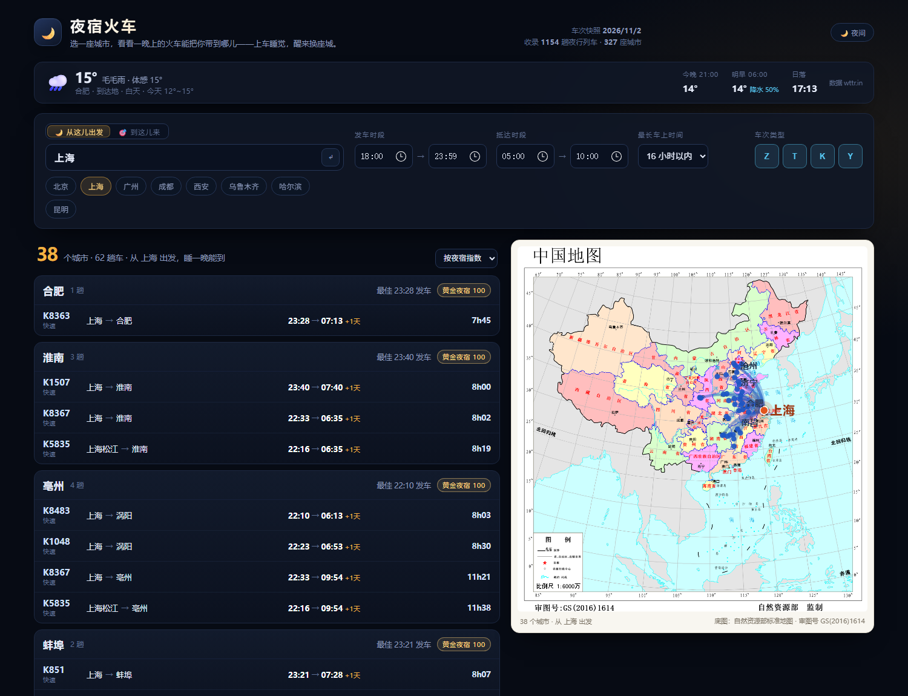

# 🌙 夜宿火车

> 选一座城市，看看一晚上的火车能把你带到哪儿。

[](https://et4f.github.io/night-train/)
[](https://night-train.etaf0305.workers.dev/)
[](LICENSE)
[](#关于-ai)



输入一座城市，列出**所有能坐一夜卧铺车抵达的城市**——傍晚上车、清晨到站，
把一晚住宿睡在铁轨上。

- 🌙 **两个方向**：从这里出发能睡到哪 / 哪些城市能一夜睡到这儿
- 📊 **夜宿指数**：按发车时间、到达时间、车上时长加权打分，90 分以上是
  「睡前不用赶、醒来正好七八点」
- 🗺️ **官方地图**：自然资源部标准地图，审图号 GS(2016)1614，含南海诸岛与台湾
- 🌦️ **到达地天气**：今晚几度、明早下车几度、要不要带伞
- ☀️ **白天 / 夜间**两套配色，一键切换

## 在线体验

**<https://et4f.github.io/night-train/>**

> 国内访问 github.io 偏慢，另有一个 Cloudflare 镜像（部署方法见 [DEVELOPMENT.md](DEVELOPMENT.md#国内访问为什么慢怎么解)）：
>
> **<https://night-train.etaf0305.workers.dev>**

## 开始使用

**直接用（推荐）**：下载 [`夜宿火车-便携版.zip`](https://github.com/et4f/night-train/releases)，
解压后双击 `夜宿火车.html`。单个文件约 1 MB，不需要安装、不需要联网。

**本地跑开发版**（需要 Node.js 18+，零依赖）：

```bash
node server/server.mjs      # 或双击 start.bat
# → http://127.0.0.1:8787
```

## 数据

来自中国铁路 12306 公开时刻表，覆盖全部 **Z / T / K / Y** 字头普速卧铺列车、**D** 字头动卧，以及 **G** 字头的夜间高铁（如 G900 香港西九龙→上海虹桥）：

| | |
| --- | --- |
| 车次 | 约 1350 趟（随每日更新浮动） |
| 车站 | 1300 座 |
| 城市 | 336 座 |

时刻是**运行图计划时刻**，不是当日实际开行，出行前请以 12306 为准；
不含票价、余票、卧铺席别；只收夜间开行的车次：白天跑的高铁、动车、城际一律不收。

更新数据（约 3–5 分钟）：

```bash
node scripts/01-fetch-index.mjs      # 车次索引
node scripts/02-fetch-schedules.mjs  # 经停时刻（可断点续传）
node scripts/03-build.mjs            # 生成 data/app.json
node scripts/07-build-docs.mjs       # 重建 docs/
```

或直接双击 `refresh.bat`。仓库每天北京时间 06:17 会自动做一次同样的更新并发布。

## 地图

底图取自**自然资源部「标准地图服务」**发布的《中国地图》1:6000 万，
**审图号 GS(2016)1614**，完整包含南海诸岛、台湾岛、钓鱼岛，未作任何裁切。

程序用双标准纬线等角圆锥投影把经纬度贴到图上（参数由图上经纬网反推拟合）。

> ⚠️ 使用该底图须遵守标准地图服务的规定：不得修改地图内容、不得裁掉南海诸岛、
> 必须标注审图号。

## 关于 AI

本项目由 **dsv4.1flash** 于 2026 年 11 月生成，人类负责需求、验收与发布。

GitHub 对 AI 辅助编写代码**没有强制标注要求**——平台政策里唯一相关的条款是
[GitHub Synthetic Media and AI Tools](https://docs.github.com/en/site-policy/acceptable-use-policies/github-synthetic-media-and-ai-tools)，
它只禁止用 AI 生成违法内容（CSAM、极端主义宣传、未经同意的私密影像），与正常写代码无关。
这里自愿注明来源，方便你判断代码质量与可信度。

## 更多

接口细节、反向代理、每日自动更新机制、地图投影标定方法，见 [DEVELOPMENT.md](DEVELOPMENT.md)。

## 免责声明

- 本项目与 12306、中国国家铁路集团**无任何关联**，不代表官方，也不提供购票、抢票、余票查询。
- 数据为**每天更新一次**的运行图计划时刻，非实时，仅作出行参考；实际开行以 12306 为准。
- 车次数据为公开时刻表信息，不含用户数据；抓取频率极低（每天约 1300 次请求，间隔 400ms），
  不影响 12306 正常服务。
- 如权利方认为本项目不妥，请通过仓库 Issue 联系，会**立即停止更新并删除数据**。

## License

代码 [MIT](LICENSE)；地图版权归自然资源部，使用时须标注审图号 GS(2016)1614。
